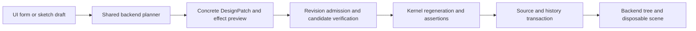

# ADR-058: Backend-only desktop editing

Status: Accepted

Task: MCAD-P14-001. Implementations follow MCAD-P14-002 → MCAD-P14-003 →
MCAD-P14-004 as registered in the roadmap.

## 1. Purpose and current evidence

Enable feature-tree editing, semantic selection-to-patch and an interactive
sketcher in Tauri while preserving backend ownership of the Design Graph.
This ADR defines the implementation contract and acceptance plan; it adds no
editor feature and earns no maturity points.

The current frontend is `apps/desktop/ui/main.js`, `index.html` and `styles.css`;
Tauri adapters are in `apps/desktop/src-tauri/src/lib.rs`. Shared helpers in
`modules/desktop` expose inspection, preview, intent, picking, parameters and
history. `modules/desktop/tests/command_parity.rs` audits handler/route parity
headlessly. These establish a foundation, not an interactive feature editor.

`modules/desktop/src/patch.rs` already stages a validated DesignPatch and
regenerates a disposable candidate before replacing source. Parameter/history
helpers currently apply structural history and write source without invoking
that geometry verification helper. New desktop editing must verify CAD
regeneration before publication; source validation alone is insufficient.

Frontend selection suggestions currently include feature-ID/role heuristics.
Suggestions may remain view hints; backend semantic/graph admission must resolve
every selection used to create a mutation.

## 2. Ownership and shared commands

Frontend owns camera, viewport presentation, selected row/display state and form
drafts. Backend owns source, graph-derived feature rows, supported capabilities,
explicit-unit admission, semantic bindings, DesignPatch planning/verification,
regeneration, history and persistence. Tauri adapts shared typed commands and
queries. Every model command has a CLI or Agent route; MCP exposes the same
backend behavior where applicable. Queries do not mutate documents.

Forms submit operation intent with stable source IDs and explicit units. They
do not edit graph files, execute constraints/body operations, or create source
relationships from renderer indices or opaque OCCT handles. Source belongs in
`.ocad`; BREP, tessellation, scene data and editor overlays remain disposable.
Backend DTOs and command results expose no OCCT types.

Backend query rows describe admitted forms/capabilities and authoritative current
values/expressions. Product controls must expose usable feature/sketch actions;
a raw source JSON editor does not satisfy feature creation or sketch editing.
Unsupported editing families are stated explicitly and do not receive inferred
support from a generic serialized DTO.

## 3. Plan, verify and publish

The shared command planner returns a concrete DesignPatch, current source
revision and expected effect/impact evidence. Applying it checks the revision,
stages source and history on disposable copies, validates source/reference/unit
invariants and regenerates the candidate through the kernel. Publication writes
the candidate and returns updated history/tree/scene only after verification
succeeds. File persistence uses the existing file transaction boundary.

Failure/refusal preserves previous source, history and published outputs. A
batch failure restores its checkpoint; it is not repaired with a guessed number
of undo calls. No-op commands keep the existing no-op verification semantics.
Undo/redo executes in backend history with current-document admission and
regeneration before publishing a changed scene. Any history transported through
the frontend stays opaque and unmodified; the UI does not rewrite snapshots.

Length inputs use explicit units and backend SI metres; angles use explicit
units and backend radians; dimensionless inputs are labelled. Source expressions
and stable IDs survive edits. UI pixels/camera/draft coordinates do not become
CAD units through an implicit frontend conversion.

## 4. Source identity and selection

Feature rows and reorder/suppress operations reference graph feature IDs.
Reorder and suppression must admit dependency/profile/reference validity; a
consumer cannot silently move to another body/profile or bypass a suppressed
source. Backend revision checks protect concurrent/stale edits.

Selection-generated changes carry backend-resolved semantic source identity and
the source/scene revision against which the selection was made. Missing,
ambiguous, stale or unsupported bindings refuse before source/history changes.
Renderer group/index/coordinates may help identify a view hit but do not own the
source binding. Parameter-name guesses and feature-ID substrings cannot bind a
mutation. Preview states the exact patch/effect for review before apply.

Interactive sketch overlays are drafts. Backend commands own creation/editing
of points, primitives, constraints, workplanes, profiles and solve diagnostics.
Cursor motion may update a view draft; source commits use verified DesignPatch.
Start with admitted primitives and explicit workplanes. Projected generated
geometry stays derived; edit its authored source/binding. New sampling methods,
general splines or NURBS editing require their separate admission ADRs.

## 5. Sequence, format and budget

MCAD-P14-002 introduces the feature-tree editor and verified backend gateway,
including the source-only parameter/history publication gap above.
MCAD-P14-003 adds semantic selection patch planning/review/apply.
MCAD-P14-004 adds interactive sketch drafts and validated source commits.
Each task defines its bounded admitted forms/operations and intentional limits.

This ADR changes no `.ocad` schema or persisted UI model. Reuse source entities,
existing DesignPatch operations and backend history. A later persisted schema
change must update schemas, migration and source/packed/expanded round trips in
the same task. Do not introduce a GUI-owned alternative graph representation.

Reuse current crates/command helpers and plain JS Tauri frontend initially; no
new dependency is admitted here. A later material solver/FFI/runtime/dependency
cost requires an ADR justification and representative measurements. Draft
preview work must be bounded and stale asynchronous results discarded by
revision; it must not silently replace newer source or presentation.

## 6. Named acceptance evidence

Implementation tasks must provide and execute applicable evidence:

- `feature_tree_ui_and_agent_commands_produce_same_source_and_history`
- `feature_create_edit_reorder_suppress_match_both_kernel_analytic_fixture`
- `dependency_invalid_reorder_or_suppression_preserves_previous_document`
- `failed_geometry_after_staged_edit_preserves_source_history_and_output`
- `selection_patch_refuses_ambiguous_missing_and_stale_source_bindings`
- `selection_review_and_apply_preserve_semantic_source_ids`
- `interactive_sketch_commands_match_backend_constraints_and_analytic_profile`
- `interactive_sketch_failed_commit_and_undo_redo_preserve_source_identity`
- `actual_tauri_editor_interactions_match_verified_backend_results`

Static handler audits, pure form tests and headless backend smoke are useful
checks but do not alone establish interactive editor behavior. Record actual
Linux Tauri/browser interaction evidence and distinguish any IPC harness from
an actual Tauri session. Actual Windows/Codex/Cursor/Gemini host verification is
separate ecosystem evidence; local CLI/MCP success does not substitute for it.
Add examples, API/architecture docs, MCP guide, skill and feasible eval for each
implemented editor feature. All four pre-push checks and all CI still apply;
one main-target PR per task, with each predecessor merged before the next branch.

## 7. Reference, risks and consequences

[SolidCraft reference notes](../plans/solidcraft-reference.md) motivate shared
commands and checkpoint rollback. These are architectural practices; no upstream
application execution, copied code or Fusion benchmark/workflow parity is claimed.

Risks include scene/source drift, dependency invalidation, heuristic rebinding,
unit-kind errors, stale history, writes before regeneration, frontend/backend
divergence, unsupported geometry exposed as editable, and overstated UI coverage.
Backend admission and atomic verified publication define the enforcement point.
The architecture prioritizes a consistent command contract and reviewable source
changes; editor convenience must preserve those boundaries.
